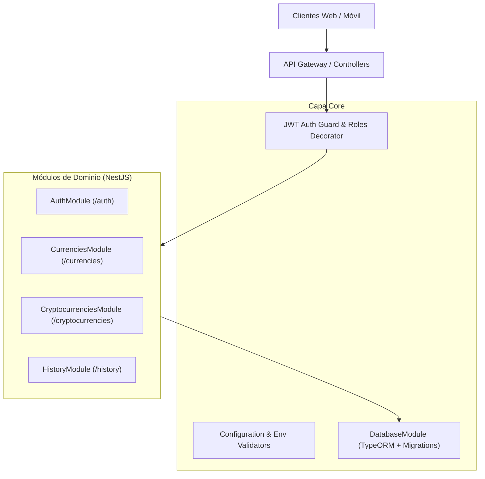

# CryptoExchange API

> **API RESTful de Alta Disponibilidad para Cotización, Intercambio y Trazabilidad de Criptoactivos y Divisas.**  
> Desarrollado con **NestJS, TypeScript, TypeORM y PostgreSQL / MySQL**.

---

## 1. Visión General
**cryptoexchange-api** es un backend profesional modular diseñado para plataformas de intercambio y gestión de activos digitales. Centraliza la administración de monedas fiduciarias (`currencies`), criptomonedas (`cryptocurrencies`), autenticación de usuarios con JWT/RBAC e historial histórico de cotizaciones (`history`).

---

## 2. Arquitectura de Módulos (Clean Architecture)



---

## 3. Módulos y Catálogo de Endpoints

### 3.1 Módulo de Autenticación (`/auth`)
- `POST /auth/register` — Registro de nuevos usuarios con validación de DTO (`RegisterUserDto`) y hash bcrypt.
- `POST /auth/login` — Autenticación de credenciales, retorno de Access Token JWT (`@Public()` decorator).

### 3.2 Módulo de Monedas Fiduciarias (`/currencies`)
- `GET /currencies` — Listado de monedas de curso legal activas (USD, EUR, VES, etc.).
- `GET /currencies/:id` — Detalle de moneda fiduciaria.
- `POST /currencies` — Creación de nueva moneda (requiere JWT).
- `PUT /currencies/:id` — Actualización de parámetros o tasa referencial.
- `DELETE /currencies/:id` — Desactivación de moneda.

### 3.3 Módulo de Criptoactivos (`/cryptocurrencies`)
- `GET /cryptocurrencies` — Listado de criptomonedas listadas (BTC, ETH, USDT, etc.).
- `GET /cryptocurrencies/:id` — Detalle de criptomoneda con su red y contrato.
- `POST /cryptocurrencies` — Alta de nuevo token o criptoactivo soportado.
- `PUT /cryptocurrencies/:id` — Actualización de estado y decimales.

### 3.4 Módulo de Historial y Cotizaciones (`/history`)
- `GET /history/crypto/:id` — Registro histórico de variaciones de precio por intervalo.
- `GET /history/currency/:id` — Registro histórico de tasas de cambio fiduciarias.

---

## 4. Base de Datos y Migraciones

La base de datos utiliza **TypeORM** con migraciones versionadas en `src/core/database/migrations/`:
1. `01-CreateUserTable.ts` — Tabla `users` (id, email, password, roles, timestamps).
2. `02-CreateCurrencyTable.ts` — Tabla `currencies` (código ISO, símbolo, nombre, estado).
3. `03-CreateCryptoCurrencyTable.ts` — Tabla `cryptocurrencies` (símbolo, nombre, red, decimales).
4. `04-CreateHistoryTable.ts` — Tablas de historial de tasas y precios de mercado.

---

## 5. Puesta en Marcha

### Prerrequisitos
- Node.js (v18+) y npm / pnpm.
- Base de datos relacional (PostgreSQL o MariaDB/MySQL).

### Pasos de Instalación
1. **Instalar paquetes:**
   ```bash
   npm install
   ```
2. **Configurar variables de entorno:**
   ```bash
   cp .env.example .env
   ```
   Ajuste las variables de conexión a base de datos y clave secreta JWT en `.env`.
3. **Ejecutar migraciones:**
   ```bash
   npm run migration:run
   ```
4. **Iniciar en desarrollo:**
   ```bash
   npm run start:dev
   ```
5. **Compilar para producción:**
   ```bash
   npm run build
   npm run start:prod
   ```

---

## 6. Documentación Adicional
Consulte [`Database.md`](./Database.md) para el detalle de atributos y tipos de datos de cada entidad.
